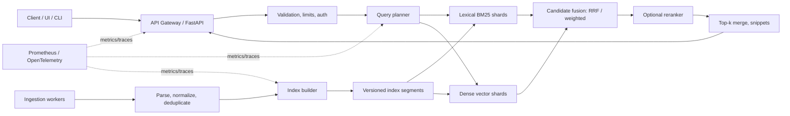

# Search Engine from Scratch — Hybrid Retrieval at 8.8M-Document Scale

A systems-oriented search engine that combines classical information retrieval with semantic retrieval, compressed indexing, and distributed query execution. The goal is to evolve a fast research prototype into a reproducible, observable, medium-scale production-style system.

> **Important:** The benchmark numbers in the project description (8.84M documents, 0.86 ms typical search, p99 12.6 ms, ~30-second indexing, 3.65× memory reduction, and nDCG@10 improvement from 0.646 to 0.792) are project-reported results, not independently verified by this blueprint. Preserve them only if your benchmark scripts, hardware details, corpus, and evaluation runs substantiate them. New capabilities below are a target roadmap until implemented and tested.

## What makes this a flagship project?

- **Retrieval from first principles:** tokenization, inverted indexes, postings, BM25, candidate generation, and score fusion.
- **Hybrid search:** lexical BM25 plus dense-vector retrieval, with configurable fusion and optional reranking.
- **Index efficiency:** integer encoding, delta coding, block compression, memory mapping, and measured memory/latency trade-offs.
- **Distributed query path:** shard routing, parallel fan-out, top-k merge, replica selection, timeout handling, and partial-result policy.
- **Production engineering:** API validation, rate limits, structured logs, metrics, tracing, health checks, load tests, CI, containerization, and deployment manifests.
- **Search quality:** qrels-based offline evaluation, nDCG@k, MRR, Recall@k, Precision@k, and latency/throughput benchmarks.
- **Reliability:** snapshots, checksums, versioned index manifests, graceful shutdown, backpressure, and fault-injection tests.

## Architecture at a glance



## Scope and design choices

This project is intended for **medium-range production-style workloads**, not as a claim of web-scale readiness. Begin with one machine and immutable index segments; add multiple shards and replicas only after single-node correctness and profiling are repeatable.

Recommended stack:
- Python 3.11+ for API, orchestration, evaluation, and tooling
- C11 for profiled hot paths (tokenization, postings decoding, or scoring)
- NumPy for vectorized preprocessing and evaluation
- FastAPI + Uvicorn for HTTP
- Pydantic for request/response contracts
- pytest + Hypothesis for tests and property checks
- Prometheus-compatible metrics + OpenTelemetry tracing
- Docker Compose for local multi-service development
- GitHub Actions for CI
- Optional: Redis for bounded caching; object storage for index snapshots; a vector index implemented by you or a clearly isolated library adapter

Do not add Kafka, Kubernetes, a database, or a cache just to make the stack look larger. Add each component only when it solves a measured requirement.

## Repository layout

```text
search-engine/
├── README.md
├── ARCHITECTURE.md
├── ROADMAP.md
├── CONTRIBUTING.md
├── pyproject.toml
├── Dockerfile
├── compose.yaml
├── Makefile
├── .env.example
├── .gitignore
├── config/
│   ├── development.yaml
│   └── production.example.yaml
├── data/
│   ├── raw/.gitkeep
│   ├── processed/.gitkeep
│   └── eval/.gitkeep
├── docs/
│   ├── benchmark-methodology.md
│   ├── operations-runbook.md
│   ├── threat-model.md
│   └── decisions/
│       ├── 0001-immutable-index-segments.md
│       └── 0002-hybrid-score-fusion.md
├── scripts/
│   ├── download_corpus.py
│   ├── build_index.py
│   ├── run_benchmark.py
│   ├── evaluate_quality.py
│   └── generate_demo_data.py
├── src/search_engine/
│   ├── __init__.py
│   ├── config.py
│   ├── api/
│   │   ├── app.py
│   │   ├── dependencies.py
│   │   ├── schemas.py
│   │   ├── middleware.py
│   │   └── routes/
│   │       ├── health.py
│   │       ├── search.py
│   │       └── admin.py
│   ├── ingestion/
│   │   ├── readers.py
│   │   ├── normalize.py
│   │   ├── deduplicate.py
│   │   └── pipeline.py
│   ├── index/
│   │   ├── builder.py
│   │   ├── manifest.py
│   │   ├── segments.py
│   │   ├── compression.py
│   │   ├── mmap_store.py
│   │   └── c_ext/
│   │       ├── tokenizer.c
│   │       └── README.md
│   ├── retrieval/
│   │   ├── tokenizer.py
│   │   ├── postings.py
│   │   ├── bm25.py
│   │   ├── dense.py
│   │   ├── fusion.py
│   │   ├── rerank.py
│   │   └── snippets.py
│   ├── distributed/
│   │   ├── router.py
│   │   ├── shard_client.py
│   │   ├── fanout.py
│   │   ├── merge.py
│   │   └── replica_policy.py
│   ├── observability/
│   │   ├── logging.py
│   │   ├── metrics.py
│   │   └── tracing.py
│   ├── security/
│   │   ├── auth.py
│   │   ├── rate_limit.py
│   │   └── input_limits.py
│   └── cli.py
├── tests/
│   ├── unit/
│   ├── property/
│   ├── integration/
│   ├── distributed/
│   ├── quality/
│   └── performance/
└── deploy/
    ├── prometheus/
    └── dashboards/
```

## Quick start (initial scaffold)

The blueprint is an architecture/documentation starting point, not a complete implementation of every module.

```bash
python -m venv .venv
# Linux/macOS
source .venv/bin/activate
# Windows PowerShell
# .venv\\Scripts\\Activate.ps1

python -m pip install --upgrade pip
pip install -e ".[dev]"
pytest
```

Add a minimal end-to-end vertical slice before filling every module:
1. Load a small JSONL corpus.
2. Normalize and tokenize documents.
3. Build an on-disk inverted index.
4. Run BM25 top-k retrieval.
5. Expose `GET /v1/search?q=...`.
6. Evaluate against a small judged query set.
7. Record latency and relevance metrics.
8. Only then add dense retrieval, compression, sharding, and replicas.

## API contract (proposed)

### `GET /v1/search`

Query parameters:
- `q`: required query, bounded length
- `k`: result count, default 10, capped by configuration
- `mode`: `lexical`, `hybrid`, or `semantic`
- `filters`: optional allow-listed structured filters
- `debug`: privileged-only scoring diagnostics

Example response:

```json
{
  "query": "distributed inverted index",
  "mode": "hybrid",
  "results": [
    {
      "doc_id": "doc-123",
      "title": "Distributed Indexing",
      "url": "https://example.org/document",
      "snippet": "...inverted index...",
      "score": 0.812,
      "rank": 1
    }
  ],
  "took_ms": 4.21,
  "index_version": "2026-10-12T00:00:00Z-build42",
  "partial": false
}
```

The values above are illustrative, not benchmark claims.

Other endpoints:
- `GET /health/live` — process is alive
- `GET /health/ready` — index loaded and dependencies available
- `GET /metrics` — metrics endpoint, restricted to internal network
- `POST /admin/index/reload` — authenticated, audited index reload
- `GET /admin/index/status` — active version, shard health, document count

## Search pipeline

1. **Query validation:** reject oversized input, malformed filters, and unsupported modes.
2. **Normalization:** use the same normalization and tokenization rules as indexing.
3. **Candidate generation:** lexical and/or dense retrieval independently return bounded candidate lists.
4. **Score fusion:** Reciprocal Rank Fusion (RRF) is a robust baseline when scores from lexical and vector systems are not calibrated. Weighted normalized scores are an alternative after calibration.
5. **Reranking:** optional cross-encoder reranks only the top N candidates; enforce a strict time budget and fallback to fused ranking on timeout.
6. **Top-k merge:** merge shard results deterministically with stable tie-breaking.
7. **Response shaping:** snippets, source metadata, index version, latency, and partial-result flag.

## Ranking and evaluation

Track retrieval quality separately from systems performance.

**Quality metrics**
- nDCG@10: graded ranking quality
- MRR@10: position of the first relevant result
- Recall@100: coverage of relevant documents
- Precision@10: relevance among the top ten
- Zero-result rate and query-class breakdowns

**Systems metrics**
- p50 / p95 / p99 latency, measured client-side and server-side
- throughput at a stated concurrency level
- error and timeout rates
- CPU, RSS, page faults, disk I/O, cache hit rate
- index build duration, peak RAM, final index size
- per-shard latency and fan-out overhead

Publish corpus version, hardware, OS/kernel, warm-up procedure, concurrency, query distribution, cache policy, and number of repetitions for every benchmark. Do not compare latency numbers from different conditions as if they were equivalent.

## Medium-production readiness checklist

- [ ] Immutable, versioned index segments with manifest and checksums
- [ ] Atomic index activation and rollback to prior version
- [ ] Ingestion idempotency and duplicate handling
- [ ] Bounded queues and backpressure
- [ ] Request timeout budget propagated to shard calls
- [ ] Per-shard deadlines and cancellation
- [ ] Replica health checks and bounded retries
- [ ] Explicit partial-results policy
- [ ] Query and payload size limits
- [ ] Authentication for administrative endpoints
- [ ] Rate limiting and abuse controls
- [ ] Structured logs with request IDs
- [ ] Metrics and distributed tracing
- [ ] Liveness/readiness checks
- [ ] CI with unit, integration, quality, and smoke tests
- [ ] Load tests with reproducible workload
- [ ] Backup, restore, and index rollback drill
- [ ] Dependency and container vulnerability scanning
- [ ] Data licensing, PII handling, retention, and deletion policy
- [ ] Runbook for degraded shards, stale replicas, failed builds, and rollback

## Reproducible benchmark policy

Every published performance claim should include:
- exact commit SHA and configuration
- corpus name, version, document count, and byte size
- machine model, CPU cores, RAM, storage, OS, and compiler flags
- cold-start versus warm-cache conditions
- query set and request distribution
- concurrency and duration
- p50/p95/p99, throughput, error rate, and confidence/repetition details
- index size and peak memory
- quality metrics on a fixed qrels set

Keep a baseline report in `docs/benchmark-methodology.md`; store raw results as machine-readable JSON or CSV. Avoid reporting only the fastest run.

## Security and data handling

- Treat corpus documents and query text as untrusted input.
- Never expose arbitrary file paths or unrestricted index reload paths through the API.
- Keep admin endpoints private and authenticated.
- Avoid logging raw queries by default if they may contain sensitive data.
- Pin dependencies and scan images.
- Do not commit datasets, embedding files, secrets, or large generated indexes to Git; use documented download/build steps and checksums.

## Roadmap

See [ROADMAP.md](ROADMAP.md) for staged implementation priorities and acceptance criteria.
